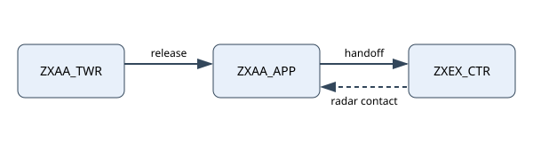
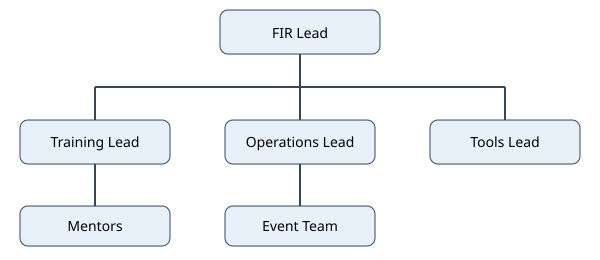

<!--
All text in this handbook is invented for testing. Exampleland, ZXEX, ZXAA, ZXBB and
ExampleSitu do not exist. The handbook intentionally uses every authoring feature:
Part and Subpart headings, titles at several levels, a chain down to a subclause,
repealed sections and paragraphs, a numbering gap, tables with spans, footnotes (also
inside a table cell), underline and highlight, {keep}, {break}, {page} and {nopage},
figures and cross-references (also to the companion glossary).
-->

[6] # Exampleland FIR Policy

[600.01] # Introduction
This handbook describes how the Exampleland FIR (ZXEX) runs its virtual air traffic control service.

[600.01(1)] # Purpose
This handbook is the single policy document for the Exampleland FIR. It replaces earlier informal notes and gives members one place to look for the rules that apply to them.

[600.01(1)(a)] It is written for members, students, mentors, staff and visitors alike.

[600.01(1)(b)] It sets policy. How-to guidance for individual positions lives in separate practice documents that carry no policy statements.

[600.01(2)] # Applicability
This handbook applies to every member of the FIR, whenever they are connected to the network or active in a related community space.

[600.01(2)(a)] Members are expected to read the handbook before their first session and to re-read it when a new version is announced.

[600.01(2)(b)] Where this handbook and a parent organization's policy disagree, the parent organization's policy applies.

[600.01(3)] # Amendments
Changes are shown in the published change summary and in the following manner:

- Additions are shown ==like this==.
- Deletions are shown ~~like this~~.
- Terms with a special meaning are shown ++like this++ the first time they are used; see [[example-glossary#600.01(1)]] for the definitions.

[600.01(4)] # Document family
The handbook belongs to a small family of documents. Each has a clear purpose and a single owner.

[600.01(4)(a)] The handbook (this document) holds policy.

[600.01(4)(b)] Practice guides explain techniques for towers, terminals and the enroute sector.

[600.01(4)(c)] Short notices, valid for a limited period, carry temporary instructions; once a notice becomes permanent it is merged into the handbook.

[600.01(5)] # Interpretation
The words in this handbook have their everyday meaning unless a definition says otherwise.

[600.01(5)(a)] "Shall" and "must" describe obligations. "Should" describes a recommendation that members follow unless they have a good reason not to.

[600.01(5)(b)] "May" describes a permission and "may not" describes a prohibition.

[600.01(5)(c)] Headings are for convenience and do not change the meaning of the text under them.

[600.01(6)] # Conduct
Members behave in a way that makes the FIR a welcoming place, on the network and elsewhere.

[600.01(6)(a)] Members treat each other and pilots with courtesy, patience and respect.

[600.01(6)(b)] Controllers are fully engaged while logged on. Distractions such as games or unrelated browsing are not appropriate when traffic needs attention.

[600.01(6)(c)] Controller information lines are for information that helps pilots, for example:

- the airports covered by the position;
- the expected log-off time;
- a link to the sector map;
- the availability of datalink services.

[600.01(6)(d)] A member who breaks a rule may face counseling, a referral to the parent organization or removal from the FIR, at the discretion of the FIR Lead.

[600.01(7)] # Version history
The table lists the published versions of this handbook.

| Version | Effective | Summary |
| --- | --- | --- |
| 1.0 | 2024-01-10 | First release of the handbook. |
| 1.1 | 2024-09-01 | Clarified currency and leave rules. |
| 2.0 | 2025-03-01 | Added datalink, events and quick reference. |

[601] # Training and Qualification

[601.01]{page} # Training
Training in the FIR is voluntary, unpaid and guided by the people who do it for the enjoyment of the community.

[601.01(1)] # Principles
Training aims to produce controllers who are safe, courteous and consistent.

[601.01(1)(a)] Students progress at their own pace. Nobody is ranked against anybody else.

[601.01(1)(b)] Feedback about a student is given to the student's mentor or instructor, not to the student directly and not in public.

[601.01(1)(c)] Mentors and instructors lead by example and are expected to know the documents listed in [[600.01(4)]].

[601.01(2)] # Stages and expectations
The training path has four stages. The table summarises what each stage involves and how long it normally takes.[^pace]

| Stage | Focus | Typical duration |
| --- | --- | --- |
| Foundation | Theory, tools and phraseology | 4 weeks |
| Ground | Ground and tower positions | 8 weeks |
| Terminal | Approach and departure | 12 weeks[^cell] |
| Enroute | Centre sector | 12 weeks |
| Summary of stages || 36 weeks |

[^pace]: Durations are guidance only. A mentor may recommend a faster or slower pace for an individual student.

[^cell]: The terminal stage includes at least two supervised sessions during an organized event.

[601.01(2)(a)] A student prepares for every session by reading the assigned material beforehand.

[601.01(2)(b)] A student who cannot attend a booked session tells the mentor as early as possible.

[601.01(2)(c)] Students do not pressure staff for extra sessions or earlier assessments.

[601.01(3)] # Assessment
Each stage ends with a practical assessment. The assessment is run by an instructor who did not teach the student at that stage.

[601.01(3)(a)] The assessment covers phraseology, coordination and situational awareness.

[601.01(3)(b)] A student who does not pass receives written feedback and may retry after a cooling-off period of two weeks.

[601.01(3)(c)] Assessment results are recorded as described in [[700.01(1)]].

[601.01(4)]{keep} # Mentors
Mentors give students extra practice between formal sessions. They are not instructors and do not run assessments.

[601.01(4)(a)] A mentor does not give a student their first lesson on a position.

[601.01(4)(b)] A mentor does not guide students at the mentor's own level.

[601.01(4)(c)] A mentor who wishes to run simulator sessions asks the Training Lead for approval first.

[601.01(5)] # Resources
Students have access to a small library of material.

[601.01(5)(a)] The library contains the handbook, the practice guides, recorded examples and a set of practice scenarios.

[601.01(5)(b)] Students tell their mentor about material that is out of date or unclear.

[601.01(5)(c)] Practice scenarios run on the simulator server and are booked in advance.

[601.01(6)] # Special positions
Some positions need an endorsement in addition to a stage.

[601.01(6)(a)] Endorsements are granted by the Training Lead after a practical assessment.

[601.01(6)(b)] An endorsement lapses if the controller has not used it for twelve months.

[601.01(6)(c)] A controller whose endorsement has lapsed may regain it through a short refresher session.

[601.01(7)] # Visitors
Visitors from other regions are welcome.

[601.01(7)(a)] Visitors are expected to know the content of this handbook.

[601.01(7)(b)] Visitors who control fewer than three hours in a quarter may be removed from the visitor roster.

[601.01(8)] # Instructors
Instructors run assessments and guide students through the stages.

[601.01(8)(a)] An instructor has controlled at least fifty hours in the FIR at the relevant level.

[601.01(8)(b)] An instructor keeps written notes of every session and stores them in the central repository.

[601.01(8)(c)] An instructor who stops teaching returns to the instructor's previous role without penalty.

[601.01(8)(d)] Instructors are recommended by the Training Lead and approved by the FIR Lead.

[601.01(8)(e)] An instructor never assesses a student whom the instructor mentored at that stage.

[601.20] # Duties of the Training Lead
The Training Lead's duties are set out below in as much detail as the FIR needs.

[601.20(1)] # Training program

[601.20(1)(a)] Run the training program.

[601.20(1)(a)(i)] Keep the list of students and mentors up to date.

[601.20(1)(a)(i)(A)] Review the student list every month.

[601.20(1)(a)(i)(A)(I)] Remove students who have left the FIR.

[601.20(1)(a)(i)(A)(II)] Tell the Operations Lead when a student is removed.

[601.20(1)(a)(i)(B)] Publish the updated list to staff within a week of each review.

[601.20(1)(a)(ii)] Assign a mentor to every new student.

[601.20(1)(b)] [repealed] Withdrawn on 2025-03-01.

[601.20(1)(c)] Report training progress to the FIR Lead every quarter.

[601.20(2)] # Endorsements
The Training Lead keeps the register of endorsements.

[601.20(2)(a)] The register shows the holder, the position and the date of the assessment.

[601.20(2)(b)] The register is reviewed together with the roster every quarter.

[602] # Operations

[602.01] # Controlling
This section holds the rules for providing control service in the FIR. Controlling is a shared responsibility and every controller is expected to know it well.

[602.01(1)] # Authorization
A controller connects to a position only when authorized for it.

[602.01(1)(a)] Authorization is granted by the Operations Lead or a delegate and recorded in the roster.

[602.01(1)(b)] A student with a solo permission uses it only on the position named in the permission. Other positions are staffed only under the supervision of a mentor or instructor.

[602.01(1)(c)] The enroute positions require the enroute endorsement. All other positions are unrestricted.

[602.01(2)] # Currency
Controllers stay current by controlling regularly.

[602.01(2)(a)] Every controller controls at least three hours in each calendar quarter.

[602.01(2)(b)] A controller who expects to miss a quarter may request a leave of absence from the Operations Lead.

[602.01(2)(b)(i)] Only one leave is granted in any eighteen months.

[602.01(2)(b)(ii)] A leave lasts no longer than six months.

[602.01(2)(b)(iii)] A leave ends as soon as the controller connects to control.

[602.01(2)(c)] A controller who misses two consecutive quarters without a leave may be marked inactive and may be asked to recertify before returning to a position.

[602.01(3)]{keep} # Releases and handoffs
Departures from ZXAA are released by the approach position and handed off to the enroute position as shown in [[fig:handoff]].

{#fig:handoff width=85% align=center}

[602.01(3)(a)] The tower asks for a release before an aircraft departs from a runway other than the active one.

[602.01(3)(b)] The approach position grants or refuses the release and may grant a blanket release for a defined set of aircraft.

[602.01(3)(c)] Once the aircraft is identified and climbing, the approach position hands it off to the enroute position. Handoffs are completed before the aircraft reaches the sector boundary.

[602.01(3)(d)] A controller who cannot meet these timings tells the next position as early as possible.

[602.01(4)] # Phraseology
Consistent phraseology reduces misunderstandings.

[602.01(4)(a)] Controllers use the approved phraseology of the Exampleland authorities.

[602.01(4)(b)] Informal phrases and phraseology from other countries are avoided, even when they seem harmless.

[602.01(4)(c)] A phraseology guide is kept in the controller resources area. If it disagrees with an official source, the official source wins.

[602.01(5)] # Datalink
Datalink messages are an optional way to exchange clearances and requests.

[602.01(5)(a)] Controllers may offer datalink services but are not required to.

[602.01(5)(b)] The ExampleSitu tool supports departure clearances and enroute messages. Controllers who offer datalink announce it in their controller information.

[602.01(5)(c)] Datalink is not used for busy terminal interactions.

[602.01(6)] # Events
Events bring traffic to the FIR and are planned well in advance.

[602.01(6)(a)] The Operations Lead approves every event before it is announced.

[602.01(6)(b)] An event plan names the airports, the positions needed and the expected traffic levels.

[602.01(6)(c)] Controllers who sign up for an event are expected to attend or to give notice as early as possible.

[602.01(6)(d)] During an event the Operations Lead or a delegate acts as event coordinator and is the point of contact for neighbouring units.

[602.01(7)] # Neighbouring units
The FIR coordinates with neighbouring regions according to written agreements.

[602.01(7)(a)] Controllers follow the current agreements as published in the resources area.

[602.01(7)(b)] A controller who is unsure of an agreement asks the Operations Lead before acting on an assumption.

[602.01(7)(c)] New agreements are announced to members before they take effect.

[602.01(8)] # Unusual situations
Controllers sometimes meet situations the handbook does not describe.

[602.01(8)(a)] In an unusual situation, safety and clear communication come first.

[602.01(8)(b)] A controller who is unsure asks the next position or a more experienced colleague for advice.

[602.01(8)(c)] Unusual situations are reported to the Operations Lead afterwards so the handbook can be improved.

[602.01(9)] # Tower practice
Tower positions work close to the runway and have the shortest reaction times.

[602.01(9)(a)] Tower controllers scan the whole movement area before issuing a line-up or take-off clearance.

[602.01(9)(b)] Tower controllers tell the approach position about every departure that does not use the active runway.

[602.01(9)(c)] A tower controller who is unsure of a runway state asks the pilot rather than assuming.

[602.01(9)(d)] A tower controller uses the departure information of the airport in the controller information line.

[602.01(9)(e)] Tower controllers hand off departing aircraft before they leave the airport boundary.

[602.01(10)] # Terminal practice
Terminal positions sequence arrivals and departures.

[602.01(10)(a)] Terminal controllers publish the expected approach in the information broadcast.

[602.01(10)(b)] Terminal controllers give arrivals the speed and altitude restrictions in the airport procedures.

[602.01(10)(c)] Terminal controllers keep departures clear of arrivals until separation is established.

[602.01(10)(d)] Terminal controllers tell the tower about expected delays.

[602.01(11)] # Enroute practice
The enroute position covers the whole FIR above the terminal areas.

[602.01(11)(a)] The enroute controller accepts handoffs from the terminal positions before the aircraft reaches the boundary.

[602.01(11)(b)] The enroute controller uses datalink for routine requests where the pilot supports it.

[602.01(11)(c)] The enroute controller coordinates with neighbouring units before an aircraft leaves the FIR.

[602.01(11)(d)] The enroute controller tells the Operations Lead about any extended period of heavy traffic.

[602.05] # Software Use
Software helps controllers but it must never get in the way of providing service.

[602.05(1)] # Approved tools
Only approved software is used for control sessions.

[602.05(1)(a)] The current approved list is kept in the resources area and replaces any earlier list.

[602.05(1)(b)] Controllers use the current sector files published by the Tools Lead.

[602.05(1)(c)] Students use only the tools supported by the FIR. More experienced controllers may add other tools provided their service does not suffer.

[602.05(2)] # Information broadcasts
Automated information broadcasts are published only by controllers who may control the airport concerned.

[602.05(2)(a)] Broadcasts contain only information that can be acted on in the simulation. Items such as closed taxiways or construction activity are left out.

[602.05(2)(b)] The standard weather profiles supplied by the FIR are not modified, except by controllers at the enroute level who may add airport conditions.

[602.05(3)]{break} # Voice and recording
Controllers connect to the voice server in an FIR channel before they log on to a position.

[602.05(3)(a)] Channel nicknames reflect the member's real first name.

[602.05(3)(b)] Controllers do not stay deafened for long periods while connected.

[602.05(3)(c)] Training channels are used for training only.

[602.05(3)(d)] Controllers may stream or record their own sessions when the parent organization's rules allow it. Students on a solo permission or in a training session do not.

[602.05(4)] # Reporting problems
Software sometimes fails.

[602.05(4)(a)] A controller who finds a fault tells the Tools Lead and gives the steps needed to reproduce it.

[602.05(4)(b)] Controllers do not publish workarounds for faults without the Tools Lead's agreement.

[602.05(4)(c)] Known faults and their workarounds are listed in the resources area.

[602.05(5)]{page} # Additional tools
Controllers may use additional tools to help their service.

[602.05(5)(a)] Additional tools must not change the information shown to other controllers.

[602.05(5)(b)] A controller who uses an additional tool is able to give the same service without it.

[602.05(5)(c)] The Tools Lead may ask a controller to stop using a tool that causes problems.

[602.05(5)(d)] New tools are proposed to the Tools Lead before members are encouraged to use them.

[602.08] [repealed] Withdrawn on 2025-03-01; replaced by [[602.05]].

[602.60] # Handoff coordination
This section sets out how positions coordinate a handoff in detail.

[602.60(1)] # Sequence of a handoff

[602.60(1)(a)] The sending position identifies the aircraft to the receiving position.

[602.60(1)(b)] The receiving position acknowledges the identification and states any restriction.

[602.60(1)(c)] The sending position transfers control only when the aircraft is ready, that is:

[602.60(1)(c)(i)] the aircraft is established on the agreed route, and

[602.60(1)(c)(i)(A)] the aircraft is identified by the receiving position; and

[602.60(1)(c)(i)(B)] the aircraft is clear of conflicting traffic, which means:

[602.60(1)(c)(i)(B)(I)] the required separation exists at the time of transfer; and

[602.60(1)(c)(i)(B)(II)] the separation is expected to remain for at least two minutes.

[602.60(1)(c)(ii)] the pilot has been told which frequency to contact.

[602.60(2)] # Failed handoffs
A handoff that does not complete is handled as follows.

[602.60(2)(a)] The sending position keeps the aircraft and informs the receiving position.

[602.60(2)(b)] The aircraft is not turned toward the boundary until the handoff has completed.

[7] # Administration and Reference

[700.01] # Administration
Administration keeps the FIR running between sessions.

[700.01(1)] # Records
The FIR keeps a small number of records and keeps them well.

[700.01(1)(a)] The roster, training records and assessment results are held in the FIR's central repository.

[700.01(1)(b)] Records are accessible to staff who need them and to nobody else.

[700.01(1)(c)] Assessment records are kept for as long as the member remains in the FIR.

[700.01(2)] # Review cycle
Policy is reviewed on a fixed schedule.

[700.01(2)(a)] The handbook is reviewed once a year.

[700.01(2)(b)] Practice guides and notices issued under [[600.01(4)]] are reviewed every quarter.

[700.01(3)] # Contacts
Questions about this handbook go to the FIR Lead at lead@example.test.

[700.01(3)(a)] Questions about training go to the Training Lead at training@example.test.

[700.01(4)] [repealed] Withdrawn on 2025-03-01; replaced by [[700.01(3)]].

[700.01(5)] # Complaints
Members may raise a complaint about service or conduct.

[700.01(5)(a)] Complaints are sent in writing to the FIR Lead.

[700.01(5)(b)] The FIR Lead acknowledges a complaint within seven days and tells the complainant what will happen next.

[700.01(5)(c)] A complaint about the FIR Lead is sent to the parent organization.

[700.01(5)(d)] Complaints are handled in confidence.

[700.01(6)] # Leaving the FIR
Members may leave at any time.

[700.01(6)(a)] A member who wishes to leave tells the Operations Lead.

[700.01(6)(b)] A member who has left and wishes to return applies again and may be asked to complete a short refresher.

[700.02] # Organization
The FIR is run by a small team of volunteers.

[700.02(1)] # Roles
The structure of the team is shown in [[fig:org]].

{#fig:org width=80% align=center}

[700.02(1)(a)] The FIR Lead is accountable for the FIR to the parent organization.

[700.02(1)(b)] The Training Lead runs the training program and the mentors.

[700.02(1)(c)] The Operations Lead looks after the roster, currency and events.

[700.02(1)(d)] The Tools Lead maintains sector files and supported software.

[700.02(2)] # Selection of staff
Staff are chosen by the FIR Lead.

[700.02(2)(a)] A candidate is a home controller in good standing.

[700.02(2)(b)] A candidate shows commitment, patience and good communication, and accepts constructive criticism.

[700.02(2)(c)] A candidate for an instructional role has controlled at least fifty hours in the FIR at the relevant level.

[700.02(3)] # Terms of appointment
Staff appointments have a fixed term.

[700.02(3)(a)] Appointments last one year and may be renewed.

[700.02(3)(b)] A staff member who resigns tells the FIR Lead at least thirty days beforehand.

[700.02(3)(c)] A staff member hands over records and access to a successor.

[700.02(3)(d)] A staff member who no longer meets the requirements of [[700.02(2)]] is replaced.

[700.02(4)] # Meetings
Staff meet regularly.

[700.02(4)(a)] Staff meetings are held once a month and are open to any member who wishes to listen.

[700.02(4)(b)] Minutes are published within a week of each meeting.

[700.02(4)(c)] Decisions that change policy are recorded in the handbook through the normal amendment process.

[700.10]{nopage} # Quick Reference
The tables below repeat key facts for convenience. They do not add any rules.

[700.10(1)] # Currency at a glance
The table shows the main currency rules.

| Rule | Value |
| --- | --- |
| Minimum hours per quarter | 3 |
| Maximum leave | 6 months |
| Leaves allowed | 1 per 18 months |
| Inactivity before review | 2 quarters |

[700.10(2)] # Positions and prerequisites
The table lists the position groups and what each needs.

| Group | Positions | Prerequisite |
| --- | --- | --- |
| Tower | ZXAA_TWR, ZXBB_TWR | Ground stage |
| Terminal | ZXAA_APP, ZXBB_APP | Terminal stage |
| ^ | ZXAA_DEP | Terminal stage |
| Enroute | ZXEX_CTR | Enroute stage |

[700.10(3)] # Where to find things
Definitions are in [[example-glossary#600.01(1)]] and [[example-glossary#600.01(2)(a)]]. The handoff flow is in [[fig:handoff]] and the team structure in [[fig:org]].
