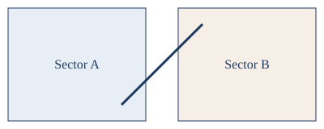

[300.01] # Scope

[300.01(1)] This policy applies to **all** controllers working the _sample_ airspace.

[300.01(2)] Handoffs shall follow the profile in [[fig:handoff]]:

[300.01(2)(a)] Initiate the handoff no later than the boundary.

[300.01(2)(b)] Confirm the frequency change.

[300.01(2)(b)(i)] Use the published frequency.

[300.01(2)(b)(ii)] Otherwise coordinate by landline.

{#fig:handoff width=70%}

[300.01(3)] This section was withdrawn.

[300.01(4)] [repealed] Withdrawn 2023-12-01.

[300.02] # Coordination

[300.02(1)] Requests are processed as described in [[300.01(2)(a)]]; see also `[[not a ref]]`.

- Verbal requests
- Written requests

| Level | Action |
| --- | --- |
| 1 | Notify |
| 2 | Coordinate |
